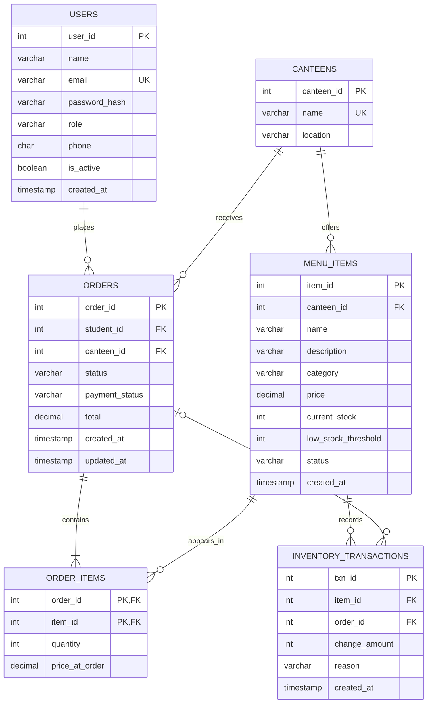
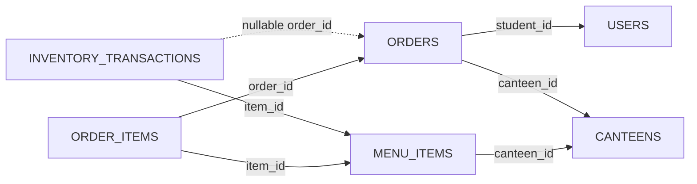

# CampusEats v2 design

## ER diagram

Primary keys are identified by `PK` in the ERD and underlined in the relational schema below. `INVENTORY_TRANSACTIONS.order_id` is nullable for restocks and other non-order stock changes. MongoDB dish details are outside this relational ER diagram.

## Relational schema

- USERS(<u>user_id</u> PK, name, email UNIQUE, password_hash, role, phone, is_active, created_at)
- CANTEENS(<u>canteen_id</u> PK, name UNIQUE, location)
- MENU_ITEMS(<u>item_id</u> PK, canteen_id FK → CANTEENS.canteen_id, name, description, category, price, current_stock, low_stock_threshold, status, created_at, UNIQUE(canteen_id, name))
- ORDERS(<u>order_id</u> PK, student_id FK → USERS.user_id, canteen_id FK → CANTEENS.canteen_id, status, payment_status, total, created_at, updated_at)
- ORDER_ITEMS(<u>order_id</u> PK/FK → ORDERS.order_id, <u>item_id</u> PK/FK → MENU_ITEMS.item_id, quantity, price_at_order)
- INVENTORY_TRANSACTIONS(<u>txn_id</u> PK, item_id FK → MENU_ITEMS.item_id, order_id nullable FK → ORDERS.order_id, change_amount, reason, created_at)

## Technology justification

MariaDB is the relational engine because it is installed by default on Fedora and supports the project's CTEs, window functions, `INTERSECT`/`EXCEPT`, stored procedures, triggers, and FULLTEXT search. The design moved from PostgreSQL to MariaDB to match the required Fedora default and the agreed setup. MongoDB stores flexible dish-specific details because attributes can vary by dish. FastAPI with PyMySQL provides a small Python API using parameterized raw SQL, while plain HTML, CSS, and JavaScript keep the frontend framework-free and are served directly by FastAPI.
